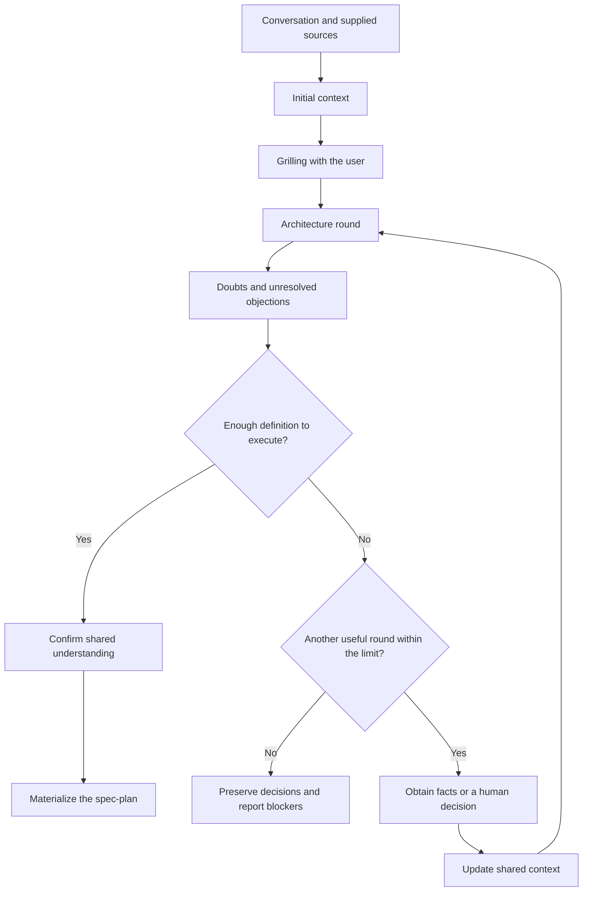
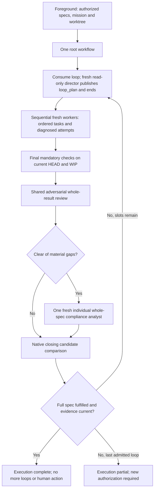

# Plan and execute migration spec

Status: implementation candidate; independent acceptance not yet established.

Admission/failure-triage correction: native owns lifecycle. The clarified
contract below supersedes historical universal process-closure requirements in
this migration design; it does not modify pi-subagents.

This document specifies the replacement for Pitako's suspended `plan` and
`execute` skills. It also requires importing Matt Pocock's `grilling` skill.
The explicit implementation request supplies authority; this document is not
itself an execution grant and never reactivates the retired engine.

This tracked document records the migration requirements. The
`.pitako/plans/<id>.md` location described below is the target storage convention
for user spec-plans. It does not change where this design document is stored.

## Goal and boundaries

`/plan` turns a conversation into complete specs. `/execute` turns those specs
into a working, verified implementation through a Ralph-style execution loop.
The execution root owns a single complete loop_plan per loop. Exhausting tasks
does not establish that the specs are satisfied.

Pitako composes Pi, pi-subagents workflows, native missions, session-local TODOs,
and Git. Pi retains model, provider, and session ownership. Pitako adds no
replacement scheduler, execution database, lease, reservation system, fencing
protocol, or managed-acceptance engine.

The first version uses sequential implementation. Parallel implementation is
deferred until the sequential workflow demonstrates that it works. Independent
read-only research and review may run in parallel.

The workflow does not install dependencies, change personal configuration,
publish, push, open a PR, merge, or rewrite Git history without separate
authorization. It preserves unrelated changes already present in the checkout.
Specs, agent results, and mission records do not grant additional permissions.

## Terms

- A **spec-plan** defines one assignment's objective, behavior, constraints,
  decisions, and acceptance criteria. It may link shared project documentation.
  It is not a project-wide specification or a fixed implementation TODO.
- An **increment** is a bounded piece of implementation, investigation, or repair
  performed by a worker with fresh context.
- A **complete cycle/loop** obtains one full read-only plan, implements its tasks,
  checks, adversarially reviews and individually analyzes full-spec compliance.
- An **invocation** is an explicit user request to `/execute`. It permits up to
  the admitted number of complete cycles (default 3). A technical recovery is not a new invocation.
- The **foreground coordinator** is the calling session. The **cycle director**
  is a separate fresh-context read-only planner that publishes and ends.

## Grilling is a packaged skill

Import the upstream
[grilling skill](https://github.com/mattpocock/skills/tree/main/skills/productivity/grilling)
as a standalone, discoverable Pitako skill. `/plan` also uses its procedure.
Preserve the upstream text, MIT license, and copyright notice. Record the
reviewed upstream revision and local source mapping through Pitako's existing
provenance and third-party notice conventions. Do not add an upstream runtime
or a dependency solely to distribute this Markdown skill.

Grilling represents the discussion as a tree of decisions. Each round asks all
questions whose prerequisites are already settled, with a recommended answer.
Questions are numbered and worded so that "yes" accepts the recommendation.
Dependent questions wait for the answers that unblock them.

The assistant obtains environmental facts through appropriate read-only
subagents rather than asking the user to research them. An investigation in
progress blocks only the questions that depend on its result. Human preferences,
scope, and product decisions remain the user's responsibility.

Grilling ends when no unresolved decision remains in the current frontier.
Before materializing the spec-plan, the caller asks the user to confirm the
shared understanding. Importing the skill does not authorize an interview,
implementation, or other effects outside the user's request.

## Planning produces specs

The planning workflow establishes initial context, clarifies the assignment,
and feeds an architecture discussion with evidence.

### Context providers support architecture

Scout supplies facts about the checkout. Researcher investigates external
documentation, dependency contracts, and supplied sources. Evidence-auditor
checks claims whose support is uncertain, contradictory, or material to a design
decision. These agents supply context, not mandatory sequential approval gates.

Initial local and external research can run in parallel when independent.
Later requests answer specific questions rather than repeat broad exploration.
Each request identifies what is unknown and which decision the answer could
change. Sources, relevant versions, limitations, and unresolved contradictions
accompany the findings.

### Doubts are resolved between architecture rounds

After each round, the architecture director identifies material uncertainty:

- Missing local facts go to Scout.
- Missing external contracts go to researcher.
- Doubtful claims or conflicting evidence go to evidence-auditor.
- Preferences and scope decisions go to the user.
- Design disagreements with adequate facts return to deliberation.

The workflow owns dispatch. Architecture participants reason about the complete
decision and do not acquire delegation responsibility. Updated context reaches
the relevant perspectives, including contrary evidence and unanswered questions.
The workflow does not silently replace their reports with the director's view.

Increase architecture's current maximum from five to ten rounds. The ten-round
ceiling applies to the same consultation, including continuations. Native
continuation references retain the consumed count. Repeated entry must not
reset the limit. Auxiliary research calls are not separate architecture rounds.

Stop earlier when no material blocker remains. Another round needs an
actionable question, new evidence, or an objection that can still be resolved.
Repeated arguments without progress do not justify continuing to the ceiling.
At the ceiling, unresolved blockers remain visible. The workflow does not force
agreement or present an incomplete design as ready.

### Spec-plan contents

Materialization records the agreed objective, scope, exclusions, expected
behavior, constraints, consequential technical decisions and their reasons,
acceptance criteria, and required verification. It includes the source context
needed by a fresh execution agent and any remaining non-blocking uncertainty.
Links can supply shared context without duplicating an entire project's docs.

Materialization does not invent missing product decisions. If writing exposes a
material gap, return to clarification rather than fill the gap silently.
Planning does not modify product code or automatically invoke `/execute`.

## Specs are discoverable across worktrees

Store generated spec-plans at `<worktree-root>/.pitako/plans/<id>.md`. Select an
initial spec-plan by explicit ID. Discovery follows the useful behavior of the
former document lookup, not its execution-binding or frozen-plan machinery:

1. Check the designated worktree's local document first.
2. If absent, search the same path in the repository's other registered
   worktrees.
3. Select a unique candidate. If several candidates remain, show their locations
   and ask for an explicit choice. Never select by modification time.

Identify a repository through its canonical Git common directory. Directory
proximity, a branch name, a Board topic, and the installed Pitako checkout do not
establish that association. Do not scan unrelated repositories or all missions
to guess a spec-plan. Validate IDs and resolved roots at the discovery boundary.
A present but invalid local document is an error, not permission to select a
different sibling document silently.

Finding a spec-plan elsewhere does not move execution there. Workers operate
in the designated worktree. Source document location and implementation location
are separate inputs.

`/execute` requires complete existing specs. If none can be selected, ask for
selection or direct the user to `/plan`. It must not invent the assignment
during implementation. Old documents are not eligible merely because the former
engine called them `frozen`. They need to satisfy the new spec-plan contract,
and no historical execution or receipt is resumed automatically.

## Execution is one root workflow

The foreground supplies authorized complete specs, explicit native mission and
designated registered worktree to `pitako.execute`. Retain actual returned
missionId AND missionPath from public mission.create/mission.show in that root;
never derive native storage paths. args.missionId matches options.missionId.
The immutable association includes invocation, full snapshot/source/digest and
Git common directory. Technical recovery retains it and the consumed count.

The admitted `pitako.execute.maxCycles` is a positive safe integer (default 3).
Pi global agent-dir `settings.json` is overridden by the designated worktree's
`.pi/settings.json`, never the source/sibling cwd. Invalid settings stop before
a director; no settings are written. The immutable native association freezes
the limit across recovery/settings edits; legacy version-2 records stay fixed
at three without migration. Reports use `Loop n de max` and consumed/max.
Early fulfillment stops; last-slot gaps need a new human invocation. Stop,
permissions, persistence and actual native host/child capacity outrank the limit.
Higher limits grant no extra native capacity. Hash-associated complete inherited
spec refs remain in all phase contexts without enlarging the selected snapshot.
See the execute skill for settings examples, sourceRefs and native capacity limits.

### One work definition and fresh workers

The root durably consumes a loop before director dispatch. A fresh read-only
director returns `plan` or `needs-decision` using outputSchema and the native
binding, then ends before implementation. It has no delegation, TODO or
supervisor orchestration. The full `loop_plan` is the sole task definition:
association, complete shared context and ordered stable IDs, goals, sources,
context references, scope/effects, expected results and concrete checks. A last
verification task is mandatory even when code already exists. A derived ID/order
manifest recovers position only, not another checklist or permission set.

Ordinary packaged workers start fresh and sequentially, with no prior transcript
fork and no async child receipts. They retain normal tools/read/progress defaults;
execute calls alone set reads:false/progress:false, suppress duplicate inferred
acceptance with explicit supported reason, and apply timeoutMs:14400000 per
implementation attempt. This does not waive required checks or native barriers,
extend the director/root or impose a logical-task deadline. No private diaries,
progress files or TODOs. A worker implements only the selected full task and
returns task/attempt, work done, concrete pending work, causal diagnosis,
Git/checkpoints/WIP, final candidate and actual command/cwd/output/log/result.
Existing checkoutEvidence identity is recorded before/after checks and after
last writes. Useful diagnosed same-task continuations get new attempt keys;
blind repetition/material replanning goes to a remaining director, without
arbitrary quotas, retries-until-green or deadline inflation.

The admitted plan owns canonical check requirements by ID. Optional descriptive
echoes remain unchanged in retained originals. Mandatory evidence is covered by
inclusion and requires valid current candidate identities before and after.
Additional diagnostics retain output, logs, result and declared identities
without normalization, including non-verifiable markers or `null` when not
captured. They neither satisfy mandatory checks nor become new gates merely
because of historical failures or unknown identity. Every entry is validated
before aggregation, even after a failure; material contradictions remain open.

### Shared adversarial review, then individual compliance

After mandatory checks, the root runs the REAL shared review: two to four dynamic
whole-result perspectives, cross-critique, one defense and synthesis, all with
complete specs/current candidate. Reasoned screening is clear/material-gaps/
blocked; include means substantiated, not blocking, and completed is protocol
termination only. Clear alone launches exactly one fresh reviewer-profile
compliance analyst, not another council. It inventories the COMPLETE specs,
including all 17 acceptance criteria and requirements beyond director tasks,
with sources, reasons and actual current check/evidence references. It returns
fulfilled/gaps/blocked. Standalone /review retains advisory authority.

Before examining the solution, workers and independent reviewers/compliance load
and apply `verify-behavior`. Their material outcome inventory starts from the
authorized request, accepted decisions and full specs, not the task plan, diff or
tests. Correctness and sufficiency both need implementation, current evidence and
limits in existing report fields. Investigate omitted outcomes, shared mistaken
assumptions and unproved connections; unresolved material counterexamples prevent
fulfillment. Explain why minor uncertainty cannot compromise the outcome. Closure
justifies fulfillment and limits, not counts. Instruction delivery tests do not
demonstrate semantic judgment by a model or add another validation phase.

No own writer is active during either analysis. Each genuine proposed close uses
one native observation to compare current candidate including WIP to evidence. Drift invalidates affected
checks/analyses. Complete requires reasoned whole-spec fulfillment, current
mandatory checks and no material in-scope gaps. Green tests, task exhaustion,
commits or finished reviews alone are insufficient. Material review/compliance
gaps end the loop and reach the next fresh director, never a hidden same-loop
global repair phase. The admitted loops without fulfillment return partial. Native
Stop, permissions/decisions, pertinent activity or actual capacity may suspend
earlier. No automatic invocation/mission, publication, commits or slot renewal.

## Recovery uses native missions and Git

Native state retains versioned immutable association, loops consumed, phase,
manifest/cursor, frozen task/attempt, intent/launch/result distinctions and exact
refs. Git preserves code/checkpoints/WIP, not acceptance receipts. Preserve exact
producer/run, outputReference/outputArtifactPath/outputPathMapping/artifactPaths
and optional results[].structuredOutputPath. Binding JSON, optional original
native value and debug artifacts are different. Consume the original complete
structuredOutput, not previews or invented paths. Store compact explicit result
projections, not full child objects/prompts/reports under allowed string fields.
Snapshot/frozen descriptor/progress are essential; failure to persist halts new
dispatch. Cache at most one identical active plan if it fits the entire 256 KiB
native state file. Do not delete history to make room.

When full values are unavailable directly, exceptional read-only inspector
recovery uses existing reads and exact retained refs, no new host loader. Compare
full JSON when original and binding survive, including scope/effects/order, not
only IDs. Missing binding with surviving authoritative original uses it in place
with exact provenance/recovery source, never copied or relocated by another
director. Changed/conflicting binding => diagnosis/no edits. Optional witness
loss does not block admitted full payload/cache. No trustworthy full definition
=> remaining director or partial, never reconstruct scopes from summaries.
Publication-before-admission recovers the actual full original result.

New plans progress through published, admitted or rejected dispositions. Before
classifying a structural defect, the root checks settled producer identity,
association and every available complete original/binding link. A never-admitted
plan with a useful scope/check/dependency diagnosis may be rejected: one essential
write retains the diagnosis, exact original/recovery refs and accounted gap.
The next ordinary director gets that corrective input within existing budget and
capacity. Replay before the write can repeat validation; after it, the rejected
plan is not recovered/readmitted and its slot is not counted twice. An unchanged
repeated defect without new corrective information blocks even with spare slots.
That diagnosed halt is essential state: losing the optional plan cache or exact
original cannot relabel it as a lost-plan gap or open another director slot.
Schema failure without a usable original is not automatically eligible; exact
settled recovery can establish eligibility. Stop, permission, capacity, settlement,
identity and persistence barriers remain. Admitted incompatible contracts stay
unresolved, never rewritten by this path.

Native replay relaunches code, not JavaScript stacks or exactly-once effects.
Never call unresolved writer keys as supposedly read-only reconnect: failed
reattachment can dispatch another writer. Reconcile available complete results and Git/WIP before cursor advance;
otherwise use checkpoint-first restoration before repeating edits. Missing
historical writer settlement alone is not a veto. Positive
pertinent queued/running/pending/detached/recovery/Stop/permission signals block
replacement even between loops. Missing inventory is not activity or a universal
historical exclusion. `reused` alone is neither success, activity nor error;
check phase, association, original descriptor and current candidate.

Review and compliance use the same rule: persist compact per-call intentions
before launch and exact producer receipts before advancing. Replay observes all
retained analysis producers before dispatching a missing call, rather than
repeating `runs.all` keys. Stop remains cancelled, permission denial blocked;
missing receipts or unsettled results cannot authorize a replacement. A current
settled original from the same producer may supersede a historical barrier,
without redispatch or automatic promotion of failed evidence. Standalone review
keeps its existing independent protocol.

Old supervisor invoke-* and pitako-execution records and Git stay unchanged.
Clearly reject obsolete supervisor replay, without migration,
deletion, new invocation or native barrier bypass. A later explicit invocation
requires actual human authorization; technical continuation never renews slots.
For a retained host transport failure with unknown cause, ordinary reentry can
perform one bounded read-only reconstruction without `--unblock`. It saves the
exact observation and intention before inspection and admission after validating
the immutable state. A pending or failed reconstruction is not a fresh route;
changing a key does not authorize another inspection. Original observations remain
retained. This does not settle interrupted writers or pending recovery queries.
Observed Stop, permission denial or positive pending activity still blocks automatic
replacement; explicit current input and native reconciliation remain necessary.

Current human continuation instead supplies `unblock:true` and `resolution:{loop,text}`
to the same mission/invocation through the registered route. A bare flag, agent
statement or historical memo is not that input. Retain the original impediment,
question, producer refs and current input before observation; loop 0 means an
interrupted request before admission, without inventing a snapshot. Matching durable
input survives technical replay even when flag/text are omitted;
acceptance is not application and neither certifies later intentions as settled.
Reconstruct association, admitted limit, Git/WIP, retained results/intentions and phase independently
of historical host-error classification. Fresh bounded read-only inspection uses
only existing grants/native policy and does not certify the old receipt's settlement.
Positive current pertinent activity, identity or scope conflicts and essential
persistence failure prevent the affected effect. Unknown historical writer status
alone does not veto checkpoint restoration or authorize query replacement.
A completed needs-decision outcome with useful current input uses the next ordinary
slot. A recorded Stop requires actual later human continuation input before effects;
never reuse that answer for a later Stop/question. Current native denial remains
binding. Reuse useful immediately available complete results, but do not require
rescuing every process/query/result before checkpoint restoration. Unknown stays
unknown; no historical closure certificate, extra inspector, redundant consent,
blind keyed redispatch, new grants or generic terminal-root restart is provided.

### Resource and presentation boundaries

Registration/setup preloads trusted complete sources. Assembly prepends a lexical
library marker to COMPLETE shared review source, then execute source; no slicing,
protocol copy, imports, nested workflows or async helpers. The resolver performs
accepted synchronous preliminary discovery I/O, without host cancellation during
that read. It reuses local-first/explicit selection in the
designated physical worktree and registered repository, not unrelated projects or
the installed package checkout. Reads of invalid oversized candidates are bounded;
valid complete snapshots remain at most 39,936 UTF-8 bytes, without arbitrary
worktree/path count limits. `JSON.stringify` transports the full spec and small
descriptor as inert data in expanded trusted source, not commands or observer
instructions. No settings, referenced-source validation or checkout evidence is
read here. The 16 KiB args limit is not an expanded-script ceiling; expanded source
is not claimed unlimited. Full specs never pass through generic CLI output.

One authorized native host admission independently rediscovers, validates all
complete sourceRefs/hashes, reads designated settings and computes checkout once.
A shared fixed-order versioned binding covers ID, physical root, canonical common
directory, selected source and complete content digest. The root compares native
and preliminary bindings before any director; disagreement blocks rather than
selecting newer bytes. Only a match permits persistence of one complete snapshot,
association, validated refs and frozen maxCycles. The versioned receipt is at most
4,096 bytes, without spec echo. Comparison does not confer authority, and separate
files are not atomically committed. Exact POSIX/Windows arguments and the Node-hook
loader remain. Settings are read only before freezing the exact invocation or its
associated interrupted admission, not on admitted reentry; partial/conflicting
state is not fresh admission and a missing receipt supplies no default.

New admissions use one initial host operation, no initial child, and one native
child per genuine closing observation. There is no packet transport, inspection
pool or loop-indexed closing-grant ceiling. Gaps without a proposed close consume
no observation. `maxCycles = 10` is accepted unchanged, not clamped or rejected
from a worst-case default child budget; it does not promise ten complete loops.
Native child, tree, session, concurrency, output, state and policy limits remain
real. Report the actual rejection with phase/work/references intact, never skip
required checks or analyses, renew slots or create another mission to evade it.
Available capacity/doctor information retains its provenance: it is context, not
a reservation or guaranteed effective limit. Unknown capacity stays unknown.

Ordinary observations use a fixed session-scoped external CLI agent registered
outside resolution through public `registerAgentViaEvents`: absolute executable,
fixed package-owned `observe.mjs` args, no model, delegation, inherited conversation
or configurable commands. Conflicting registration/native rejection is an error,
not overwrite or fallback. It ignores stdin, uses `designatedWorkspace` and
`checkoutEvidence` on actual cwd, checks physical identity and never rereads the
full plan. All stdout is bounded before emission below 65,536 bytes; an oversized
result becomes bounded complete failure JSON, never truncated JSON.

The root saves invocation/loop/unique-key intention before singleton `runs.all`,
uses `output:false`, inline mode and effective implicit waiting, validates
terminal completion/identity and one JSON `result.output` plus publication, then
saves evidence before outcome/advance. Success retains key, native run ID,
`asyncDir`, observation and actual `externalAdapter.outputArtifacts` stdout/stderr
paths, distinct across closes. Failure retains only existing fields; missing,
invalid, truncated, mismatched, nonterminal, rejected or unsuccessfully published
output (including `outputSaveError`) cannot satisfy closing. No Pi structured
output path is required from this non-Pi adapter. Observation is not review,
compliance, checks, checkpoint evidence or a full worker report. The predicate is
`sameCandidate && review clear && compliance fulfilled && checks current`.
The global mission-state bound remains 256 KiB. Essential saves block protected
operations on failure; no post-Stop persistence, fsync or permanent artifact
retention is promised. This new-admission path neither migrates retained legacy
roots nor resumes terminal roots.

### Actionable blocking diagnostics

Keep the actual cause/input, expected and observed identity/version where
available, and exact evidence references; explicitly mark unavailable observations.
Before admission, reconcile ambiguous selection, missing/read/size errors or a
disputed version, then explicitly prepare admission with the intended source.
Do not label every failure a hash mismatch or automatically select newer bytes.
After admission, preserve the original snapshot and frozen source hashes: restore
exact bytes from a reliable original, and deliver desired changes as explicit
human addenda. Without reliable originals remain blocked/partial; a revised
assignment and new admission require actual human authorization.

Retain concurrent barriers. Native Stop, rejection, uncertain activity and
essential-save failure need their supported native inspection/reconciliation
route; correcting a source cannot override them. For terminal roots, inspect
retained evidence and report only operations valid for that state, never resume
advice or a generic `--unblock`. No `--force`, silent hash replacement, extra
arbitrary approvals or restart that erases consumed work is supported.

Foreground presents existing structured progress and per-loop/final results,
not polling, private/foreground Preparation/Loop TODOs, extra agents or final
validators. Progress identifies invocation, loop/phase and task/attempt when
applicable. Each loop reports candidate, work, checks/adversarial/compliance
(including unrun/failed/stale), pending work, next authorized action and human
action needed. Original elapsed time includes pauses; token attribution is
deduplicated across replay, with reported/partial/unavailable coverage. Missing
metrics never become zero, estimates, a blocker or reason for more calls.
Re-emission consumes no loop or tokens. Do not duplicate full reports in state.

Final closure first answers fulfillment and whether the human must act:
Execution complete/partial/blocked/cancelled. Complete means fulfilled/verified,
no more loops or human action required. Partial/blocked names concrete gaps or
impediment and distinguishes technical continuation from new authorization
after the admitted maximum. A pending decision is blocked with the concrete question;
child timeout alone is not invocation cancellation. The last loop report and
closure may share a message. Publication and Git/WIP are reported separately.

## Owned integration scope

Expose the migrated skills through ordinary Pi package resources. Thin prompts
can provide `/plan` and `/execute` entry points without a new lifecycle API.
Replace suspension guidance only when the implementation is ready. Keep the
catalog, router, profile guidance, and public docs consistent.

Relevant existing resources include `skills/plan/SKILL.md`,
`skills/execute/SKILL.md`, `skills/architecture/workflow.js`,
`skills/review/workflow.js`, `agents/`, `prompts/`, `package.json`, and
`extensions/catalog.ts`. Reuse the existing architecture and review contracts
rather than copy their protocols into unrelated coordinators.

No packaged child delegates: the root owns execution dispatch and shared phases.
Director/inspector/reviewer are read-only; worker retains its ordinary providers
and defaults. No agentOverrides or settings changes supply missing authority.

## Acceptance and verification

Implementation checks must cover these observable requirements:

- Grilling is packaged, discoverable, attributed, and retains its reviewed
  upstream procedure.
- Planning requests the user decisions that are needed, researches facts through
  context providers, and materializes specs only after shared-understanding
  confirmation.
- Architecture incorporates new evidence between rounds, retains unanswered
  objections, and cannot exceed ten rounds through continuation.
- Spec discovery prefers local documents, finds unique sibling documents,
  rejects unrelated repository matches, and asks on ambiguity.
- Selecting sibling specs leaves implementation in the designated worktree.
- Execution requires complete specs and retains a concrete invocation input.
  Source edits do not silently change it.
- The root owns one schema-bound loop_plan per loop and all task/attempt dispatch.
  Director ends before workers; no foreground/private child TODO supervision.
- Increment workers and each new cycle director start with fresh context.
  Implementation has only one writer at a time.
- Overall review uses the complete specs and current evidence. Completing a TODO
  or receiving a successful native run is not a success verdict.
- Review gaps move to the next cycle. The admitted number of complete cycles exhausts one
  invocation, while fewer tasks or more than three increments do not.
- A partial execution can receive another explicit invocation without losing
  work. Technical recovery does not reset the active allowance.
- WIP commits, uncommitted work, missing mission updates, and native failures
  remain distinguishable from verified completion.
- Recovery does not start a new writer against positively observed current pertinent
  activity or actual native barriers; missing historical settlement alone is no veto.
- Publishing, history rewriting, unrelated edits, and legacy-engine recovery do
  not become implicit effects of these commands.

Use controlled native boundaries to test Pitako's scripts, profiles, resources,
and decisions. Reuse the current architecture, review, and composition fixtures
where their ownership fits. Cover success, spec gaps, ambiguity, failure, and
controllable interruption without certifying dependency internals or external
host UI behavior.

For implementation acceptance, follow the active project's
[verification guide](../GATES.md). In this checkout the complete procedure is
`bun run typecheck` followed by `bun run test`, with normal discovery. Focused
checks do not replace that procedure. This design-only document supplies no
runtime test evidence.

## Design evidence

- [Engineering boundaries](engineering.md),
  [current architecture](architecture.md), and [current review](review.md)
  establish the existing composition and retirement boundary.
- Installed pi-subagents `0.82.0` documents native missions, script-owned dispatch,
  explicit child delegation, and async-workflow relaunch in `docs/missions.md`,
  `docs/workflows.md`, `docs/agents.md`, and `docs/extension-api.md`.
  It documents agent-mediated nesting, not `runs.workflow`. Its durable
  recovery is native, not an integration with `pi-durable`.
- Installed rpiv-todo `2.15.0` partitions TODO storage by session and persists
  mutations as `rpiv-todo-state` session entries, including calls through codemode.
  Pitako's `extensions/todo.ts` preserves upstream tool exposure.
- Historical commit `2d6435d` introduced cross-worktree document discovery.
  The pre-retirement sources at `deffc71`, including `extensions/workflow.ts`,
  `extensions/board/workspace.ts`, and `tests/frozen-plan.test.ts`, describe its
  behavior. Commit `d305195` retired that runtime.
- [Ralph](https://ghuntley.com/ralph/) supplies the fresh-context, persisted-work
  iteration model. This design distinguishes increment iterations from the
  configurable complete execution cycles allowed per invocation (default 3).

## Candidate implementation notes

### Single-result task contract

The director output binding fixes the complete association to the active root
and current loop, including mission paths, invocation, worktree/common Git root,
selected source/digest, admitted limit and complete inherited source identities.
Post-binding admission still rejects conflicting originals without rewriting them.

New director tasks use `expectedResult` for one concrete observable outcome and
include `dependsOn: [{taskId, reason}]` (or `[]`). Split separable outcomes while
keeping coordinated code/tests together; file/line/task quotas do not define
size. Prefer genuine independence, declaring shared resources in scope/effects.
The root checks full dependency shapes, known IDs, no self/duplicates, nonblank
reasons and strictly earlier prerequisites, excluding cycles. Independent task
permutations are valid before admission. Full admitted definitions/order remain
immutable; recovery never sorts, splits, repairs or infers independence from
missing old metadata. Final verification stays last even with an empty list.

Workers remain sequential, with one writer. A dependent task waits for durable
completion and receives exact full-result references to completed direct
prerequisite attempts from existing results, never failed/intermediate attempts.
Those references are historical, not current passing checks or integration
evidence. Check relevant current assumptions without automatically rerunning all
prerequisite gates. Review/compliance receive the admitted plan by reference and
retain independent full-spec coverage; schema cannot prove semantic decomposition
or complete dependencies. Correct completed work is not repeated to improve past
decomposition.

Future task worktrees start at candidate HEAD current at creation, never a frozen
initial base or a copy of WIP. Existing worktrees are not automatically
updated/rebased; completion/result references alone do not prove integration
into HEAD. Candidate evolution does not change immutable specs, definitions or
order. Verification still binds the actual candidate including WIP. This fixes
design direction only, without worktree creation, concurrency, integration
automation or commit policy.

The packaged plan skill keeps all human grilling and final confirmation in the
foreground. Its context script and the existing architecture workflow dispatch
read-only evidence providers; planning consultations retain counts in native
mission state. Specs use a v1 complete-document header and substantive named
sections; shape validation is not human authentication or semantic completeness.

Execution registers one session-scoped named resource through the public API,
disposed on shutdown/re-registration, with only exact read-only Git/spec host
commands. It snapshots source/digest/content in native mission state, separately
from implementation cwd. Preliminary serialized data and one compact native
admission replace chunked source transport, retaining the 39,936-byte UTF-8 spec
boundary (shared docs may be linked, never truncated).
The native host-command API mandates a finite per-operation timeout; the native
24-hour maximum applies only to these read-only reads, not workflow/agent budgets.

Loop slots and frozen attempts persist before dispatch. Controlled tests cover
original full-plan recovery, binding conflict/loss, optional witness loss,
publication/result/cursor cuts, current-candidate replay and native barriers.
Recovery first consumes complete native originals; optional binding witnesses
are not prerequisites. Exceptional observation uses exact retained references
only. Compact recovery records save the immutable subject/stage and association,
source refs, stable key and intent before the external query, and disposition
before admission. Replay reconciles the retained result, not a replacement query
when settlement is uncertain. Renamed keys/paths do not renew the route.
Admission is durable before cursor movement and the next existing phase runs
inside the active root. Essential persistence failure stops dispatch.

Technical recovery never expands task/stage objectives, resources, effects,
permissions or budget. Functional gaps keep ordinary loop accounting. An action
requiring broader scope is not performed: preserve evidence and name its actor,
concrete impediment and specific expansion needed. Report actions describe
pending obligations, not necessarily human consent. Continuation is announced
as started only with its retained native reference; no generic resume of
failed/completed roots, new replacement root or foreground polling is provided.

No historical marker/closure ceremony or bare --unblock bypass survives. Tests exercise
shared review with two/three/four angles and findings, native capacity exhaustion,
full state-file bounds and compact projection of large reports. Maximum UTF-8
snapshots/metadata, inert preliminary transport, immutable association and bounded
synchronous discovery in resolve remain owned guarantees. Presentation checks
cover per-loop/combined final reports, decisions, unrun checks, pauses and partial/unavailable metrics.

The vendoring seams present in this checkout are `scripts/vendor-engineering-layer.py`
and `docs/provenance.json`; no parallel provenance registry is introduced.
Installed dependency version does not prove a running host has reloaded it.
Controlled implementation tests are evidence of owned behavior, not provider or
host certification. Independent review and the parent-owned full gate remain.

The packaged architect, execution director and worker load Ponytail in FULL mode:
reuse code, avoid speculative abstractions and choose the simplest complete solution.
Reviewers always apply ponytail-review to correctness, safety, tests and simplicity. This
never reduces assigned specs/scope, weakens required tests or replaces acceptance
criteria. Project instructions and output schemas/reporting take precedence over
generic Ponytail prose/test-minimization preferences; upstream bytes are unchanged.

Read-only review/compliance protocol rejections can be re-evaluated in the same
invocation after a reader correction, without relaunching their completed producers
or consuming an implementation loop. Findings associate screening assessments by
`findingId`, not literal requirement wording; sources, consequences and verdict
consistency remain required. Originals are never rewritten.

A recovery query's returned producer reference is saved before body validation or
admission. Replay observes that exact producer, reading its full retained original
when management supplies only a preview; it never dispatches a replacement query
or treats a key as read-only reattachment. Originals come from native state or an
associated `structuredOutputPath`, not invented paths.

For newly bound invocations, resource expansion carries exact retained read-only
originals as inert data, separately from the full spec. Native admission
independently recomputes their projection digest; a difference blocks before
consumption. Only already-associated current-loop producers qualify, including
pending recovery inspectors; conflicting bodies or producer escapes are rejected.
The compact admission receipt carries the comparison digest and applicable
checkpoint observation, not complete originals. Ordinary cwd-only closing does
not deliver recovery payloads. `inspectionSnapshot` and unrelated inspector
consumers remain available. This path does not migrate or revive legacy roots.
Complete originals stay outside essential mission state. Required originals that
remain unavailable are evidence gaps, not permission to reconstruct from previews;
optional witness loss alone does not block a surviving authoritative original.
Comparison or essential-save failure prevents admission, never truncates evidence
or silently recaptures it.

### Pending-unit preimages

Before a writer dispatch the root durably binds a checkpoint intention to the
unchanged association, loop/cursor, task/attempt and admitted-plan reference.
The bound writer calls registered `checkpoint_create({kind:"pre", paths:[...]})`
before checkout writes; native launch context supplies the actual durable attempt
and progress. It returns structured artifact references, not model-assembled
capture/seal scripts or receipts. Missing/stale context fails closed. The same
owned capture/seal operations back the tool and existing helper, not a parallel
journal. Keep `skills/execute/checkpoint.mjs` for journaled apply and selective
restore; see the execute skill. `kind:"unit"` seals completed writes and `kind:"pause"`
preserves pending WIP only while native control permits capture. Return the actual
`checkpointReceipt`; root durable result admission, not tool success, confirms it.
Repeated identical requests identify the existing immutable publication. Analysis
and inspector roles gain no writer capability, including via codemode. Editing
provider/profile files does not reload already active sessions. Retained legacy
attempts preserve their original contract, not retroactive bindings or backups. The exact-path manifest is
not another plan or an authorization extension. It and the write-ahead effect
journal preserve previous uncommitted bytes as well as missing-file preimages.

Artifacts belong to `.pi/subagents/checkpoints/<attempt-key>/`, not private
native mission state. Restoration first retains partial state and verifies the
complete preimage/effect chain, current HEAD/index, and attributable current
bytes. It refuses unrelated edits rather than using reset/clean. Callers use checkpoint-first restoration with best-effort pertinent-writer
status/stop through authorized public operations. Native continuation, unavailable
observers and conclusive historical settlement are not prerequisites. Reuse an
immediately available valid complete result when useful. Missing historical
receipts/IDs or inconclusive status are not activity; positive current pertinent
activity is a conflict. Actual native barriers remain binding.
The returned position is reconciled in existing root state; maximum, consumed
slots, attempts and admitted results never rewind. Candidate-dependent evidence
must be compared with the restored candidate, not promoted from old logs.

An interrupted worker with an exact retained run ID can continue through the
public native child-resume operation. The root persists one continuation
intention before dispatch, keeps the original attempt/task/check contract, and
retains the successor reference before admitting its actual complete result.
An interrupted log is never passing check evidence. Replay observes that exact
continuation rather than redispatching its key; pending activity blocks effects,
but is re-observed instead of becoming a permanent historical veto. Recorded
Stop, denial, conflicts and essential-save failures remain barriers. This child
operation is not a generic terminal-root restart or proof that checkpoint fallback
is available.

A host reconstruction interrupted after its durable intention can repeat the
existing fixed pure Git/spec/retained-result projections. Admission records the
observed output reference, source digest and candidate after association and
snapshot validation, before dispatch. The earlier intention and error remain
retained. Repeating this projection is not key-based reattachment, a freshness
guarantee or proof that an earlier operation settled; native replay/cache policy
still applies. Pending model queries, writers and restorations are not covered
by this pure-read exception. Observed Stop, permission, activity, capacity and
essential-persistence barriers continue to prevent unsafe effects.

### Confirmed checkpoint-first continuation

Capture real affected-file bytes, including previous WIP, before modifying and
bind coherent unit/task/cursor/admitted-progress references. Seal settled unit
writes; durable root result admission confirms the new point. A cooperative
pause may save pending WIP only while native control permits capture, without
extra task edits. Stop/refusal or abrupt loss uses the last confirmed point,
never an invented post-cut capture. Preserve partial bytes before selective
restoration, unrelated changes and confirmed work. Missing/corrupt bytes or real
file conflicts remain gaps; no reset/clean or fabricated backups.

Recovery is checkpoint-first after best-effort pertinent-writer status/stop through
available authorized public operations. Native resume and perfect historical
settlement are not prerequisites; missing receipts, unavailable observers,
inconclusive status and historical IDs alone are not activity. Positive current
pertinent activity is a conflict. Actual native Stop/refusal/permission/capacity
and essential-save barriers remain binding. A recorded Stop requires a real later
human continuation request before effects, never reuse of an old answer.
Restoration never rewinds consumed loops, attempts, admitted results or immutable
originals. Renew evidence invalidated by the restored candidate, then reach pending
work, final checks, review and compliance.

New admissions accept `amendments: [{path, sha256, provenance}]` (default `[]`,
multiple entries allowed), with full Markdown sources inside the designated
worktree. Native admission verifies physical containment and full SHA-256 before
the director; missing/changed bytes block with path, expected/observed digest
and reconciliation guidance, without automatic recapture. Human message
ID/timestamp provenance is descriptive, not authentication. References freeze
in `invocation.amendments`, outside the base association/snapshot/sourceRefs and
without renewing budget. Recovery requires identical references and revalidates
the bytes. The director retains paths in sharedContext.references and hashes/
provenance in sharedContext.material for worker, review and compliance. The
existing resolution delivery route is unchanged. See execute skill syntax.

Separately delivered current human amendments remain separate from the admitted
base snapshot/sourceRefs/association. They remain effective without replacing base
hashes, renewing the budget or causing a false base-source discrepancy; editing
a frozen source still blocks. Carry their complete path, SHA-256 and
human-delivery provenance in existing admitted plan shared context and exact
plan/result references. Workers, review and compliance must read/hash the FULL
amendment before affected work or whole-spec assessment and retain that provenance
in results/reasons. Missing/changed bytes are a prerequisite gap, not permission
to replace frozen sources, infer authority from agent text, or renew the budget.
Preserve known unmet historical evidence obligations; new checkpoint observations
do not establish an unavailable historical before-state contrast.
