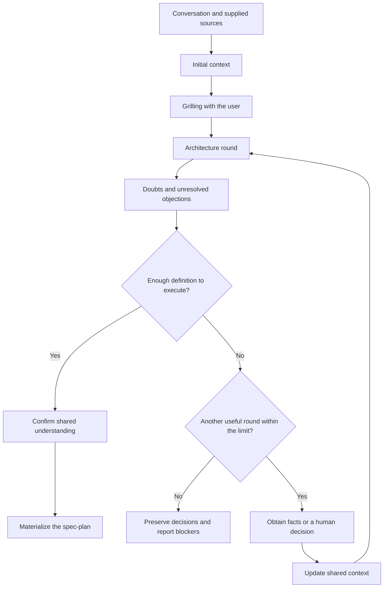
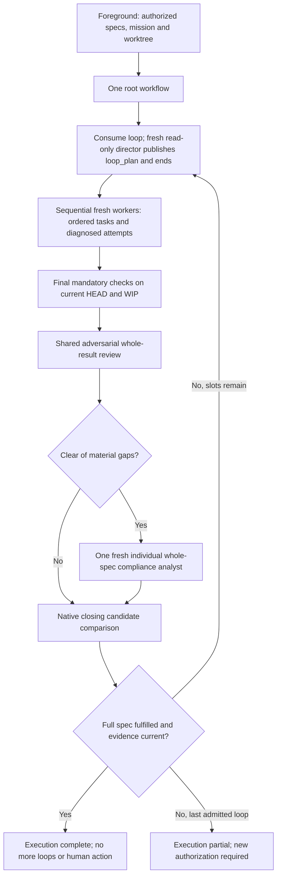

# Plan and execute migration spec

Status: implementation candidate; independent acceptance not yet established.

Admission/failure-triage correction: native owns lifecycle. The clarified
contract below supersedes historical universal process-closure requirements in
this migration design; it does not modify pi-subagents.

This document specifies the replacement for Pitako's suspended `plan` and
`execute` skills. It also requires importing Matt Pocock's `grilling` skill.
The explicit implementation request supplies authority; this document is not
itself an execution grant and never reactivates the retired engine.

This tracked document records the migration requirements. The
`.pitako/plans/<id>.md` location described below is the target storage convention
for user spec-plans. It does not change where this design document is stored.

## Goal and boundaries

`/plan` turns a conversation into complete specs. `/execute` turns those specs
into a working, verified implementation through a Ralph-style execution loop.
The execution root owns a single complete loop_plan per loop. Exhausting tasks
does not establish that the specs are satisfied.

Pitako composes Pi, pi-subagents workflows, native missions, session-local TODOs,
and Git. Pi retains model, provider, and session ownership. Pitako adds no
replacement scheduler, execution database, lease, reservation system, fencing
protocol, or managed-acceptance engine.

The first version uses sequential implementation. Parallel implementation is
deferred until the sequential workflow demonstrates that it works. Independent
read-only research and review may run in parallel.

The workflow does not install dependencies, change personal configuration,
publish, push, open a PR, merge, or rewrite Git history without separate
authorization. It preserves unrelated changes already present in the checkout.
Specs, agent results, and mission records do not grant additional permissions.

## Terms

- A **spec-plan** defines one assignment's objective, behavior, constraints,
  decisions, and acceptance criteria. It may link shared project documentation.
  It is not a project-wide specification or a fixed implementation TODO.
- An **increment** is a bounded piece of implementation, investigation, or repair
  performed by a worker with fresh context.
- A **complete cycle/loop** obtains one full read-only plan, implements its tasks,
  checks, adversarially reviews and individually analyzes full-spec compliance.
- An **invocation** is an explicit user request to `/execute`. It permits up to
  the admitted number of complete cycles (default 3). A technical recovery is not a new invocation.
- The **foreground coordinator** is the calling session. The **cycle director**
  is a separate fresh-context read-only planner that publishes and ends.

## Grilling is a packaged skill

Import the upstream
[grilling skill](https://github.com/mattpocock/skills/tree/main/skills/productivity/grilling)
as a standalone, discoverable Pitako skill. `/plan` also uses its procedure.
Preserve the upstream text, MIT license, and copyright notice. Record the
reviewed upstream revision and local source mapping through Pitako's existing
provenance and third-party notice conventions. Do not add an upstream runtime
or a dependency solely to distribute this Markdown skill.

Grilling represents the discussion as a tree of decisions. Each round asks all
questions whose prerequisites are already settled, with a recommended answer.
Questions are numbered and worded so that "yes" accepts the recommendation.
Dependent questions wait for the answers that unblock them.

The assistant obtains environmental facts through appropriate read-only
subagents rather than asking the user to research them. An investigation in
progress blocks only the questions that depend on its result. Human preferences,
scope, and product decisions remain the user's responsibility.

Grilling ends when no unresolved decision remains in the current frontier.
Before materializing the spec-plan, the caller asks the user to confirm the
shared understanding. Importing the skill does not authorize an interview,
implementation, or other effects outside the user's request.

## Planning produces specs

The planning workflow establishes initial context, clarifies the assignment,
and feeds an architecture discussion with evidence.

### Context providers support architecture

Scout supplies facts about the checkout. Researcher investigates external
documentation, dependency contracts, and supplied sources. Evidence-auditor
checks claims whose support is uncertain, contradictory, or material to a design
decision. These agents supply context, not mandatory sequential approval gates.

Initial local and external research can run in parallel when independent.
Later requests answer specific questions rather than repeat broad exploration.
Each request identifies what is unknown and which decision the answer could
change. Sources, relevant versions, limitations, and unresolved contradictions
accompany the findings.

### Doubts are resolved between architecture rounds

After each round, the architecture director identifies material uncertainty:

- Missing local facts go to Scout.
- Missing external contracts go to researcher.
- Doubtful claims or conflicting evidence go to evidence-auditor.
- Preferences and scope decisions go to the user.
- Design disagreements with adequate facts return to deliberation.

The workflow owns dispatch. Architecture participants reason about the complete
decision and do not acquire delegation responsibility. Updated context reaches
the relevant perspectives, including contrary evidence and unanswered questions.
The workflow does not silently replace their reports with the director's view.

Increase architecture's current maximum from five to ten rounds. The ten-round
ceiling applies to the same consultation, including continuations. Native
continuation references retain the consumed count. Repeated entry must not
reset the limit. Auxiliary research calls are not separate architecture rounds.

Stop earlier when no material blocker remains. Another round needs an
actionable question, new evidence, or an objection that can still be resolved.
Repeated arguments without progress do not justify continuing to the ceiling.
At the ceiling, unresolved blockers remain visible. The workflow does not force
agreement or present an incomplete design as ready.

### Spec-plan contents

Materialization records the agreed objective, scope, exclusions, expected
behavior, constraints, consequential technical decisions and their reasons,
acceptance criteria, and required verification. It includes the source context
needed by a fresh execution agent and any remaining non-blocking uncertainty.
Links can supply shared context without duplicating an entire project's docs.

Materialization does not invent missing product decisions. If writing exposes a
material gap, return to clarification rather than fill the gap silently.
Planning does not modify product code or automatically invoke `/execute`.

## Specs are discoverable across worktrees

Store generated spec-plans at `<worktree-root>/.pitako/plans/<id>.md`. Select an
initial spec-plan by explicit ID. Discovery follows the useful behavior of the
former document lookup, not its execution-binding or frozen-plan machinery:

1. Check the designated worktree's local document first.
2. If absent, search the same path in the repository's other registered
   worktrees.
3. Select a unique candidate. If several candidates remain, show their locations
   and ask for an explicit choice. Never select by modification time.

Identify a repository through its canonical Git common directory. Directory
proximity, a branch name, a Board topic, and the installed Pitako checkout do not
establish that association. Do not scan unrelated repositories or all missions
to guess a spec-plan. Validate IDs and resolved roots at the discovery boundary.
A present but invalid local document is an error, not permission to select a
different sibling document silently.

Finding a spec-plan elsewhere does not move execution there. Workers operate
in the designated worktree. Source document location and implementation location
are separate inputs.

`/execute` requires complete existing specs. If none can be selected, ask for
selection or direct the user to `/plan`. It must not invent the assignment
during implementation. Old documents are not eligible merely because the former
engine called them `frozen`. They need to satisfy the new spec-plan contract,
and no historical execution or receipt is resumed automatically.

## Execution is one root workflow

The foreground supplies authorized complete specs, explicit native mission and
designated registered worktree to `pitako.execute`. Retain actual returned
missionId AND missionPath from public mission.create/mission.show in that root;
never derive native storage paths. args.missionId matches options.missionId.
The immutable association includes invocation, full snapshot/source/digest and
Git common directory. Technical recovery retains it and the consumed count.

The admitted `pitako.execute.maxCycles` is a positive safe integer (default 3).
Pi global agent-dir `settings.json` is overridden by the designated worktree's
`.pi/settings.json`, never the source/sibling cwd. Invalid settings stop before
a director; no settings are written. The immutable native association freezes
the limit across recovery/settings edits; legacy version-2 records stay fixed
at three without migration. Reports use `Loop n de max` and consumed/max.
Early fulfillment stops; last-slot gaps need a new human invocation. Stop,
permissions, persistence and actual native host/child capacity outrank the limit.
Higher limits grant no extra native capacity. Hash-associated complete inherited
spec refs remain in all phase contexts without enlarging the selected snapshot.
See the execute skill for settings examples, sourceRefs and bounded host grants.

### One work definition and fresh workers

The root durably consumes a loop before director dispatch. A fresh read-only
director returns `plan` or `needs-decision` using outputSchema and the native
binding, then ends before implementation. It has no delegation, TODO or
supervisor orchestration. The full `loop_plan` is the sole task definition:
association, complete shared context and ordered stable IDs, goals, sources,
context references, scope/effects, expected results and concrete checks. A last
verification task is mandatory even when code already exists. A derived ID/order
manifest recovers position only, not another checklist or permission set.

Ordinary packaged workers start fresh and sequentially, with no prior transcript
fork and no async child receipts. They retain normal tools/read/progress defaults;
execute calls alone set reads:false/progress:false, suppress duplicate inferred
acceptance with explicit supported reason, and apply timeoutMs:14400000 per
implementation attempt. This does not waive required checks or native barriers,
extend the director/root or impose a logical-task deadline. No private diaries,
progress files or TODOs. A worker implements only the selected full task and
returns task/attempt, work done, concrete pending work, causal diagnosis,
Git/checkpoints/WIP, final candidate and actual command/cwd/output/log/result.
Existing checkoutEvidence identity is recorded before/after checks and after
last writes. Useful diagnosed same-task continuations get new attempt keys;
blind repetition/material replanning goes to a remaining director, without
arbitrary quotas, retries-until-green or deadline inflation.

### Shared adversarial review, then individual compliance

After mandatory checks, the root runs the REAL shared review: two to four dynamic
whole-result perspectives, cross-critique, one defense and synthesis, all with
complete specs/current candidate. Reasoned screening is clear/material-gaps/
blocked; include means substantiated, not blocking, and completed is protocol
termination only. Clear alone launches exactly one fresh reviewer-profile
compliance analyst, not another council. It inventories the COMPLETE specs,
including all 17 acceptance criteria and requirements beyond director tasks,
with sources, reasons and actual current check/evidence references. It returns
fulfilled/gaps/blocked. Standalone /review retains advisory authority.

No own writer is active during either analysis. A single native closing per loop
compares current candidate including WIP to evidence. Drift invalidates affected
checks/analyses. Complete requires reasoned whole-spec fulfillment, current
mandatory checks and no material in-scope gaps. Green tests, task exhaustion,
commits or finished reviews alone are insufficient. Material review/compliance
gaps end the loop and reach the next fresh director, never a hidden same-loop
global repair phase. The admitted loops without fulfillment return partial. Native
Stop, permissions/decisions, pertinent activity or actual capacity may suspend
earlier. No automatic invocation/mission, publication, commits or slot renewal.

## Recovery uses native missions and Git

Native state retains versioned immutable association, loops consumed, phase,
manifest/cursor, frozen task/attempt, intent/launch/result distinctions and exact
refs. Git preserves code/checkpoints/WIP, not acceptance receipts. Preserve exact
producer/run, outputReference/outputArtifactPath/outputPathMapping/artifactPaths
and optional results[].structuredOutputPath. Binding JSON, optional original
native value and debug artifacts are different. Consume the original complete
structuredOutput, not previews or invented paths. Store compact explicit result
projections, not full child objects/prompts/reports under allowed string fields.
Snapshot/frozen descriptor/progress are essential; failure to persist halts new
dispatch. Cache at most one identical active plan if it fits the entire 256 KiB
native state file. Do not delete history to make room.

When full values are unavailable directly, exceptional read-only inspector
recovery uses existing reads and exact retained refs, no new host loader. Compare
full JSON when original and binding survive, including scope/effects/order, not
only IDs. Missing binding with surviving authoritative original uses it in place
with exact provenance/recovery source, never copied or relocated by another
director. Changed/conflicting binding => diagnosis/no edits. Optional witness
loss does not block admitted full payload/cache. No trustworthy full definition
=> remaining director or partial, never reconstruct scopes from summaries.
Publication-before-admission recovers the actual full original result.

Native replay relaunches code, not JavaScript stacks or exactly-once effects.
Never call unresolved writer keys as supposedly read-only reconnect: failed
reattachment can dispatch another writer. Reconcile actual settled results and
Git/WIP, including commit-before-cursor, before repeating edits. Positive
pertinent queued/running/pending/detached/recovery/Stop/permission signals block
replacement even between loops. Missing inventory is not activity or a universal
historical exclusion. `reused` alone is neither success, activity nor error;
check phase, association, original descriptor and current candidate.

Old supervisor invoke-* and pitako-execution records and Git stay unchanged.
Clearly reject obsolete supervisor replay and --unblock, without migration,
deletion, new invocation or native barrier bypass. A later explicit invocation
requires actual human authorization; technical continuation never renews slots.

### Resource and presentation boundaries

Registration/setup preloads trusted complete sources. Assembly prepends a lexical
library marker to COMPLETE shared review source, then execute source; no slicing,
protocol copy, imports, nested workflows or async helpers. The resolver is bounded
and performs no discovery I/O. Physical registered-root/Git checks stay at launch
hooks/inspection; inspect.mjs retains Node-hook TypeScript loading and exact
POSIX/Windows argument transport. Preserve local-first complete spec selection
and the 39,936-byte UTF-8 boundary, never truncate. The existing 26 snapshot
grants plus initial, one read-only settings admission and four closing grants use at most 32 host calls. Higher admitted limits never enlarge this native capacity.
No arbitrary checks/artifact gates are added. Native host deadlines and child
spawn capacity are separate. Actual exhaustion preserves phase/work/references,
returns incomplete and never skips required analyses or overrides capacity.

Foreground presents existing structured progress and per-loop/final results,
not polling, private/foreground Preparation/Loop TODOs, extra agents or final
validators. Progress identifies invocation, loop/phase and task/attempt when
applicable. Each loop reports candidate, work, checks/adversarial/compliance
(including unrun/failed/stale), pending work, next authorized action and human
action needed. Original elapsed time includes pauses; token attribution is
deduplicated across replay, with reported/partial/unavailable coverage. Missing
metrics never become zero, estimates, a blocker or reason for more calls.
Re-emission consumes no loop or tokens. Do not duplicate full reports in state.

Final closure first answers fulfillment and whether the human must act:
Execution complete/partial/blocked/cancelled. Complete means fulfilled/verified,
no more loops or human action required. Partial/blocked names concrete gaps or
impediment and distinguishes technical continuation from new authorization
after the admitted maximum. A pending decision is blocked with the concrete question;
child timeout alone is not invocation cancellation. The last loop report and
closure may share a message. Publication and Git/WIP are reported separately.

## Owned integration scope

Expose the migrated skills through ordinary Pi package resources. Thin prompts
can provide `/plan` and `/execute` entry points without a new lifecycle API.
Replace suspension guidance only when the implementation is ready. Keep the
catalog, router, profile guidance, and public docs consistent.

Relevant existing resources include `skills/plan/SKILL.md`,
`skills/execute/SKILL.md`, `skills/architecture/workflow.js`,
`skills/review/workflow.js`, `agents/`, `prompts/`, `package.json`, and
`extensions/catalog.ts`. Reuse the existing architecture and review contracts
rather than copy their protocols into unrelated coordinators.

No packaged child delegates: the root owns execution dispatch and shared phases.
Director/inspector/reviewer are read-only; worker retains its ordinary providers
and defaults. No agentOverrides or settings changes supply missing authority.

## Acceptance and verification

Implementation checks must cover these observable requirements:

- Grilling is packaged, discoverable, attributed, and retains its reviewed
  upstream procedure.
- Planning requests the user decisions that are needed, researches facts through
  context providers, and materializes specs only after shared-understanding
  confirmation.
- Architecture incorporates new evidence between rounds, retains unanswered
  objections, and cannot exceed ten rounds through continuation.
- Spec discovery prefers local documents, finds unique sibling documents,
  rejects unrelated repository matches, and asks on ambiguity.
- Selecting sibling specs leaves implementation in the designated worktree.
- Execution requires complete specs and retains a concrete invocation input.
  Source edits do not silently change it.
- The root owns one schema-bound loop_plan per loop and all task/attempt dispatch.
  Director ends before workers; no foreground/private child TODO supervision.
- Increment workers and each new cycle director start with fresh context.
  Implementation has only one writer at a time.
- Overall review uses the complete specs and current evidence. Completing a TODO
  or receiving a successful native run is not a success verdict.
- Review gaps move to the next cycle. The admitted number of complete cycles exhausts one
  invocation, while fewer tasks or more than three increments do not.
- A partial execution can receive another explicit invocation without losing
  work. Technical recovery does not reset the active allowance.
- WIP commits, uncommitted work, missing mission updates, and native failures
  remain distinguishable from verified completion.
- Recovery does not start a new writer while prior work remains unsettled.
- Publishing, history rewriting, unrelated edits, and legacy-engine recovery do
  not become implicit effects of these commands.

Use controlled native boundaries to test Pitako's scripts, profiles, resources,
and decisions. Reuse the current architecture, review, and composition fixtures
where their ownership fits. Cover success, spec gaps, ambiguity, failure, and
controllable interruption without certifying dependency internals or external
host UI behavior.

For implementation acceptance, follow the active project's
[verification guide](../GATES.md). In this checkout the complete procedure is
`bun run typecheck` followed by `bun run test`, with normal discovery. Focused
checks do not replace that procedure. This design-only document supplies no
runtime test evidence.

## Design evidence

- [Engineering boundaries](engineering.md),
  [current architecture](architecture.md), and [current review](review.md)
  establish the existing composition and retirement boundary.
- Installed pi-subagents `0.82.0` documents native missions, script-owned dispatch,
  explicit child delegation, and async-workflow relaunch in `docs/missions.md`,
  `docs/workflows.md`, `docs/agents.md`, and `docs/extension-api.md`.
  It documents agent-mediated nesting, not `runs.workflow`. Its durable
  recovery is native, not an integration with `pi-durable`.
- Installed rpiv-todo `2.11.0` partitions TODO storage by session. Pitako's
  `extensions/todo.ts` keeps TODO mutations model-only.
- Historical commit `2d6435d` introduced cross-worktree document discovery.
  The pre-retirement sources at `deffc71`, including `extensions/workflow.ts`,
  `extensions/board/workspace.ts`, and `tests/frozen-plan.test.ts`, describe its
  behavior. Commit `d305195` retired that runtime.
- [Ralph](https://ghuntley.com/ralph/) supplies the fresh-context, persisted-work
  iteration model. This design distinguishes increment iterations from the
  configurable complete execution cycles allowed per invocation (default 3).

## Candidate implementation notes

The packaged plan skill keeps all human grilling and final confirmation in the
foreground. Its context script and the existing architecture workflow dispatch
read-only evidence providers; planning consultations retain counts in native
mission state. Specs use a v1 complete-document header and substantive named
sections; shape validation is not human authentication or semantic completeness.

Execution registers one session-scoped named resource through the public API,
disposed on shutdown/re-registration, with only exact read-only Git/spec host
commands. It snapshots source/digest/content in native mission state, separately
from implementation cwd. The bounded host stdout requires chunked source reads
and a 39,936-byte UTF-8 spec boundary (shared docs may be linked, never truncated).
The native host-command API mandates a finite per-operation timeout; the native
24-hour maximum applies only to these read-only reads, not workflow/agent budgets.

Loop slots and frozen attempts persist before dispatch. Controlled tests cover
original full-plan recovery, binding conflict/loss, optional witness loss,
publication/result/cursor cuts, current-candidate replay and native barriers.
No historical marker/closure ceremony or --unblock path survives. Tests exercise
shared review with two/three/four angles and findings, native capacity exhaustion,
full state-file bounds and compact projection of large reports. Maximum UTF-8
snapshots/metadata, transport, immutable association and no discovery in resolve
remain owned guarantees. Presentation checks cover per-loop/combined final
reports, decisions, unrun checks, pauses and partial/unavailable metrics.

The vendoring seams present in this checkout are `scripts/vendor-engineering-layer.py`
and `docs/provenance.json`; no parallel provenance registry is introduced.
Installed dependency version does not prove a running host has reloaded it.
Controlled implementation tests are evidence of owned behavior, not provider or
host certification. Independent review and the parent-owned full gate remain.

The packaged `pitako.worker` explicitly loads the existing Ponytail skill in
LITE mode: reuse code, avoid speculative abstractions and keep diffs small. This
never reduces assigned specs/scope, weakens required tests or replaces acceptance
criteria. Project instructions and output schemas/reporting take precedence over
generic Ponytail prose/test-minimization preferences; upstream bytes are unchanged.
