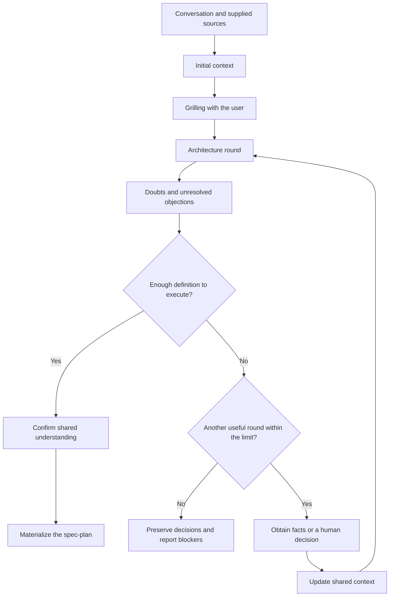
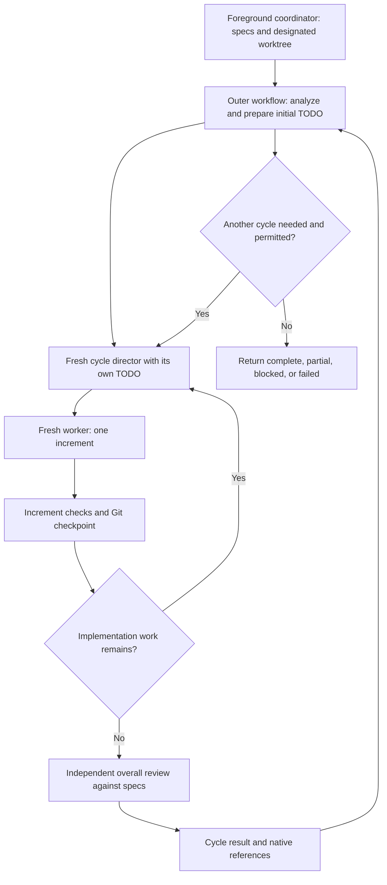

# Plan and execute migration spec

Status: implementation candidate; independent acceptance not yet established.

Admission/failure-triage correction: native owns lifecycle. The clarified
contract below supersedes historical universal process-closure requirements in
this migration design; it does not modify pi-subagents.

This document specifies the replacement for Pitako's suspended `plan` and
`execute` skills. It also requires importing Matt Pocock's `grilling` skill.
The explicit implementation request supplies authority; this document is not
itself an execution grant and never reactivates the retired engine.

This tracked document records the migration requirements. The
`.pitako/plans/<id>.md` location described below is the target storage convention
for user spec-plans. It does not change where this design document is stored.

## Goal and boundaries

`/plan` turns a conversation into complete specs. `/execute` turns those specs
into a working, verified implementation through a Ralph-style execution loop.
The implementation TODO belongs to execution and can change as work proceeds.
Completing that TODO does not establish that the specs are satisfied.

Pitako composes Pi, pi-subagents workflows, native missions, session-local TODOs,
and Git. Pi retains model, provider, and session ownership. Pitako adds no
replacement scheduler, execution database, lease, reservation system, fencing
protocol, or managed-acceptance engine.

The first version uses sequential implementation. Parallel implementation is
deferred until the sequential workflow demonstrates that it works. Independent
read-only research and review may run in parallel.

The workflow does not install dependencies, change personal configuration,
publish, push, open a PR, merge, or rewrite Git history without separate
authorization. It preserves unrelated changes already present in the checkout.
Specs, agent results, and mission records do not grant additional permissions.

## Terms

- A **spec-plan** defines one assignment's objective, behavior, constraints,
  decisions, and acceptance criteria. It may link shared project documentation.
  It is not a project-wide specification or a fixed implementation TODO.
- An **increment** is a bounded piece of implementation, investigation, or repair
  performed by a worker with fresh context.
- A **complete cycle** prepares or updates the implementation TODO, implements
  its increments, and reviews the overall result against the specs.
- An **invocation** is an explicit user request to `/execute`. It permits up to
  three complete cycles. A technical recovery is not a new invocation.
- The **foreground coordinator** is the calling session. The **cycle director**
  is a separate, fresh-context subagent responsible for one execution cycle.

## Grilling is a packaged skill

Import the upstream
[grilling skill](https://github.com/mattpocock/skills/tree/main/skills/productivity/grilling)
as a standalone, discoverable Pitako skill. `/plan` also uses its procedure.
Preserve the upstream text, MIT license, and copyright notice. Record the
reviewed upstream revision and local source mapping through Pitako's existing
provenance and third-party notice conventions. Do not add an upstream runtime
or a dependency solely to distribute this Markdown skill.

Grilling represents the discussion as a tree of decisions. Each round asks all
questions whose prerequisites are already settled, with a recommended answer.
Questions are numbered and worded so that "yes" accepts the recommendation.
Dependent questions wait for the answers that unblock them.

The assistant obtains environmental facts through appropriate read-only
subagents rather than asking the user to research them. An investigation in
progress blocks only the questions that depend on its result. Human preferences,
scope, and product decisions remain the user's responsibility.

Grilling ends when no unresolved decision remains in the current frontier.
Before materializing the spec-plan, the caller asks the user to confirm the
shared understanding. Importing the skill does not authorize an interview,
implementation, or other effects outside the user's request.

## Planning produces specs

The planning workflow establishes initial context, clarifies the assignment,
and feeds an architecture discussion with evidence.

### Context providers support architecture

Scout supplies facts about the checkout. Researcher investigates external
documentation, dependency contracts, and supplied sources. Evidence-auditor
checks claims whose support is uncertain, contradictory, or material to a design
decision. These agents supply context, not mandatory sequential approval gates.

Initial local and external research can run in parallel when independent.
Later requests answer specific questions rather than repeat broad exploration.
Each request identifies what is unknown and which decision the answer could
change. Sources, relevant versions, limitations, and unresolved contradictions
accompany the findings.

### Doubts are resolved between architecture rounds

After each round, the architecture director identifies material uncertainty:

- Missing local facts go to Scout.
- Missing external contracts go to researcher.
- Doubtful claims or conflicting evidence go to evidence-auditor.
- Preferences and scope decisions go to the user.
- Design disagreements with adequate facts return to deliberation.

The workflow owns dispatch. Architecture participants reason about the complete
decision and do not acquire delegation responsibility. Updated context reaches
the relevant perspectives, including contrary evidence and unanswered questions.
The workflow does not silently replace their reports with the director's view.

Increase architecture's current maximum from five to ten rounds. The ten-round
ceiling applies to the same consultation, including continuations. Native
continuation references retain the consumed count. Repeated entry must not
reset the limit. Auxiliary research calls are not separate architecture rounds.

Stop earlier when no material blocker remains. Another round needs an
actionable question, new evidence, or an objection that can still be resolved.
Repeated arguments without progress do not justify continuing to the ceiling.
At the ceiling, unresolved blockers remain visible. The workflow does not force
agreement or present an incomplete design as ready.

### Spec-plan contents

Materialization records the agreed objective, scope, exclusions, expected
behavior, constraints, consequential technical decisions and their reasons,
acceptance criteria, and required verification. It includes the source context
needed by a fresh execution agent and any remaining non-blocking uncertainty.
Links can supply shared context without duplicating an entire project's docs.

Materialization does not invent missing product decisions. If writing exposes a
material gap, return to clarification rather than fill the gap silently.
Planning does not modify product code or automatically invoke `/execute`.

## Specs are discoverable across worktrees

Store generated spec-plans at `<worktree-root>/.pitako/plans/<id>.md`. Select an
initial spec-plan by explicit ID. Discovery follows the useful behavior of the
former document lookup, not its execution-binding or frozen-plan machinery:

1. Check the designated worktree's local document first.
2. If absent, search the same path in the repository's other registered
   worktrees.
3. Select a unique candidate. If several candidates remain, show their locations
   and ask for an explicit choice. Never select by modification time.

Identify a repository through its canonical Git common directory. Directory
proximity, a branch name, a Board topic, and the installed Pitako checkout do not
establish that association. Do not scan unrelated repositories or all missions
to guess a spec-plan. Validate IDs and resolved roots at the discovery boundary.
A present but invalid local document is an error, not permission to select a
different sibling document silently.

Finding a spec-plan elsewhere does not move execution there. Workers operate
in the designated worktree. Source document location and implementation location
are separate inputs.

`/execute` requires complete existing specs. If none can be selected, ask for
selection or direct the user to `/plan`. It must not invent the assignment
during implementation. Old documents are not eligible merely because the former
engine called them `frozen`. They need to satisfy the new spec-plan contract,
and no historical execution or receipt is resumed automatically.

## Execution has an outer workflow and an isolated cycle director

The foreground coordinator supplies the selected specs and designated worktree
to the outer `/execute` workflow. That workflow analyzes the assignment and
checkout, prepares the initial implementation TODO, and launches the cycle
director. Model-backed analysis remains agent work, not an ability of the
JavaScript sandbox. The foreground session TODO contains high-level work such
as preparation and `Loop 1`, not every implementation task.

The outer workflow launches a fresh-context cycle director for each cycle.
This is an agent with explicitly enabled native delegation, not an invented
workflow-to-workflow script API.

### Responsibilities and context

The cycle director reads, plans, updates its detailed TODO, delegates, and
evaluates results. It does not edit product code, make small fixes itself, or
create commits. Keeping its context free of implementation work is a requirement.
Within its cycle, the director retains continuity.

Workers perform implementation and commits. The packaged `pitako.worker` is based
on pi-subagents 0.82.0 builtin worker, retaining ordinary implementation tools,
fresh context and project instructions, and adding explicit CodeGraph, LSP and
the official model-compatible apply_patch adapter with edit/write fallback. It
does not gain delegation; Pi retains model/provider selection.
Each increment starts with a fresh
worker context containing the assigned task, selected specs, applicable project
instructions, relevant evidence, and access to the current checkout. Fresh
context does not mean an empty brief or the loss of project constraints.
Workers do not inherit the previous worker's conversation.

Only one implementing worker writes in the designated worktree at a time.
The director waits for owned work before starting a conflicting writer.
Fresh context and read-only role instructions are not sandbox guarantees.

A different subagent reviews the overall result against the complete specs.
That review considers behavior, coverage, current evidence, and the project's
required checks. Passing tests alone does not prove spec compliance. Nor does
review completion establish passing checks or merge approval.

The detailed TODO belongs to the director's session. The foreground TODO does
not mirror its entries. Return a compact result, remaining work, blockers, and
native evidence references rather than all internal transcripts. Native
session-local TODO storage is the ownership boundary. This spec does not promise
how an external host such as T3 renders descendant events.

### A cycle ends with the overall review

The director can revise the implementation TODO when new facts change the work.
It can remove unnecessary tasks, reorder work within dependencies, and delegate
increment-level repairs. It does not change the specs or expand their scope.

After implementing the TODO, run the overall review. Material spec gaps become
input to the next cycle, with a new director. Do not hide another sequence of
whole-result review and repair inside the same cycle to bypass the outer limit.
Unsupported reviewer suggestions do not automatically become new requirements.
If a product decision is necessary, report the question instead of inventing
the answer.

Each invocation permits at most three complete cycles. This limit is not three
workers, three tasks, or three commits. Stop before the ceiling when the specs
are satisfied, a blocker requires a decision, or work cannot make progress.

Do not add Pitako token, price, usage, or global/worker time budgets to a cycle.
The packaged execution-director alone sets native `timeoutMs: 7200000` (two
hours). Normal usage is subscription-based; other native runtime limits remain.

A confirmed native director timeout consumes the current cycle attempt. Native
cause is not safety proof. Fresh read-only Git/known-ref observations precede
the next remaining slot in the SAME invocation. Native awaited completion handles
ordinary owned runs; positive native active/pending/detached/recovery/Stop or
permission signals block replacement. No model writersSettled boolean or universal
descendant/process-closure certificate is required. Missing/reused/refused
observations yield specific pending diagnosis and historical --unblock guidance,
never successful review or a hidden timeout retry. Three observed timeouts return
partial; later completion still needs whole-spec review and current verification.

At the ceiling, return partial work and remaining gaps. A new explicit
`/execute` invocation can authorize up to three more complete cycles on the
same execution. It renews the cycle allowance, not the implementation state.
A technical recovery retains the current invocation's count and active cycle.
Compact timeout markers and settlement references survive replay without
duplicating native task/spec payloads. Recovery never reruns a consumed timeout
cycle; an interrupted unsettled attempt still requires explicit reconciliation.
The workflow never raises its own ceiling. Raising the initial ceiling is a
future user decision based on observed stability.

Use stable invocation and cycle identities across native workflow relaunches.
Do not increment an allowance counter merely because the script starts again.
An additional explicit invocation is distinct from resuming an interrupted one.

## Recovery uses missions and Git

Use native missions for execution state, decisions, pending work, input
references, and linked runs. Use Git commits to preserve code. Do not create
another ledger, task registry, checkpoint service, or Board-owned lifecycle.
TODOs present the session's work; Board remains optional shared knowledge.
Create the mission first through native `mission.create`, or explicitly attach an
existing mission. The named `pitako.execute` launch requires the same exact ID in
`options.missionId` (native attachment) and `args.missionId` (DATA pointer for
inspector/director briefs). One-step mission creation is unsupported because the
resource resolver cannot know the new ID. This association is not human approval
or security confinement. Native validates storage existence before dispatch; no
custom ledger or ephemeral fallback is added.

Record a concrete input version for each invocation using native artifacts or
available source revisions. Retain the original location. Changes to the source
document must not silently change an active invocation's objective. Report a
changed input before adopting it through an explicit user decision.

Commits are recovery points, not acceptance receipts. Workers may use
`wip: <description>` for partial work, including known failures or unrun checks.
The mission retains that distinction and the remaining work. Do not create an
empty commit merely to mark a loop, include unrelated changes, or automatically
squash WIP history.

On continuation, inspect the mission, selected specs, actual checkout, commits,
uncommitted changes, and linked runs. Continue automatically only when the
association with the specs and designated checkout is unambiguous. Otherwise
ask. Do not interpret a stop request, transport receipt, or terminal label as
proof that all writers have settled. Resolve outstanding native work before
starting a replacement writer.

A commit may exist even when the mission update was interrupted. Uncommitted
work may also be useful. Reconcile both sources rather than discard changes or
blindly repeat work. Recovery does not promise automatic restart, exactly-once
effects, or cleanup after `SIGKILL`.

### Native workflow recovery in pi-subagents 0.82.0

Use the native async scripted-workflow recovery facilities, not `pi-durable` or
another Pitako recovery service. Native automatic continuation may resume the
same already-authorized invocation, in its original designated worktree, without
granting another three cycles or additional effects. User stop is not an
automatic-continuation request.

Native recovery relaunches the script from its beginning. Stable script, input,
invocation, and child keys let upstream reuse matching successful child results
or reattach eligible live work. This is not a restored JavaScript stack.
Native automatic-resume attempt limits are separate from the three complete
Pitako cycles.

Reuse of a director result does not establish that the current checkout still
passes its checks. Retain the associated input and evidence, inspect repository
truth, and report stale or uncertain evidence rather than declare success.
An interrupted director's internal TODO and grandchildren are not automatically
restored as individual outer-workflow steps. Its replacement must reconcile
native references, mission state, and Git before allowing another writer.
Ambiguous association blocks. Missing historical lifecycle evidence requires
specific pending diagnosis, not an invented active writer.

Host commands and steering can run again during replay. Keep those operations
read-only or idempotent; put implementation and commits in owned workers and
inspect existing effects before repeating them. No exactly-once guarantee is
added by native result reuse. Source-document discovery across worktrees does
not transfer execution ownership or change native recovery's original cwd.

## Owned integration scope

Expose the migrated skills through ordinary Pi package resources. Thin prompts
can provide `/plan` and `/execute` entry points without a new lifecycle API.
Replace suspension guidance only when the implementation is ready. Keep the
catalog, router, profile guidance, and public docs consistent.

Relevant existing resources include `skills/plan/SKILL.md`,
`skills/execute/SKILL.md`, `skills/architecture/workflow.js`,
`skills/review/workflow.js`, `agents/`, `prompts/`, `package.json`, and
`extensions/catalog.ts`. Reuse the existing architecture and review contracts
rather than copy their protocols into unrelated coordinators.

The execution director is an explicit exception to ordinary non-delegating
children. Its profile opts into nested delegation and provides the TODO and
required tool extensions. Do not enable delegation on every worker, architect,
or reviewer. Do not assume every frontmatter field is accepted by
`agentOverrides`. Profile names and helper-file layout are implementation
choices, not new product behavior.

## Acceptance and verification

Implementation checks must cover these observable requirements:

- Grilling is packaged, discoverable, attributed, and retains its reviewed
  upstream procedure.
- Planning requests the user decisions that are needed, researches facts through
  context providers, and materializes specs only after shared-understanding
  confirmation.
- Architecture incorporates new evidence between rounds, retains unanswered
  objections, and cannot exceed ten rounds through continuation.
- Spec discovery prefers local documents, finds unique sibling documents,
  rejects unrelated repository matches, and asks on ambiguity.
- Selecting sibling specs leaves implementation in the designated worktree.
- Execution requires complete specs and retains a concrete invocation input.
  Source edits do not silently change it.
- The parent TODO contains high-level loops. The director owns the detailed
  session TODO and delegates every product edit and commit.
- Increment workers and each new cycle director start with fresh context.
  Implementation has only one writer at a time.
- Overall review uses the complete specs and current evidence. Completing a TODO
  or receiving a successful native run is not a success verdict.
- Review gaps move to the next cycle. Three complete cycles exhaust one
  invocation, while fewer tasks or more than three increments do not.
- A partial execution can receive another explicit invocation without losing
  work. Technical recovery does not reset the active allowance.
- WIP commits, uncommitted work, missing mission updates, and native failures
  remain distinguishable from verified completion.
- Recovery does not start a new writer while prior work remains unsettled.
- Publishing, history rewriting, unrelated edits, and legacy-engine recovery do
  not become implicit effects of these commands.

Use controlled native boundaries to test Pitako's scripts, profiles, resources,
and decisions. Reuse the current architecture, review, and composition fixtures
where their ownership fits. Cover success, spec gaps, ambiguity, failure, and
controllable interruption without certifying dependency internals or external
host UI behavior.

For implementation acceptance, follow the active project's
[verification guide](../GATES.md). In this checkout the complete procedure is
`bun run typecheck` followed by `bun run test`, with normal discovery. Focused
checks do not replace that procedure. This design-only document supplies no
runtime test evidence.

## Design evidence

- [Engineering boundaries](engineering.md),
  [current architecture](architecture.md), and [current review](review.md)
  establish the existing composition and retirement boundary.
- Installed pi-subagents `0.82.0` documents native missions, script-owned dispatch,
  explicit child delegation, and async-workflow relaunch in `docs/missions.md`,
  `docs/workflows.md`, `docs/agents.md`, and `docs/extension-api.md`.
  It documents agent-mediated nesting, not `runs.workflow`. Its durable
  recovery is native, not an integration with `pi-durable`.
- Installed rpiv-todo `2.11.0` partitions TODO storage by session. Pitako's
  `extensions/todo.ts` keeps TODO mutations model-only.
- Historical commit `2d6435d` introduced cross-worktree document discovery.
  The pre-retirement sources at `deffc71`, including `extensions/workflow.ts`,
  `extensions/board/workspace.ts`, and `tests/frozen-plan.test.ts`, describe its
  behavior. Commit `d305195` retired that runtime.
- [Ralph](https://ghuntley.com/ralph/) supplies the fresh-context, persisted-work
  iteration model. This design distinguishes increment iterations from the
  three complete execution cycles allowed per invocation.

## Candidate implementation notes

The packaged plan skill keeps all human grilling and final confirmation in the
foreground. Its context script and the existing architecture workflow dispatch
read-only evidence providers; planning consultations retain counts in native
mission state. Specs use a v1 complete-document header and substantive named
sections; shape validation is not human authentication or semantic completeness.

Execution registers one session-scoped named resource through the public API,
disposed on shutdown/re-registration, with only exact read-only Git/spec host
commands. It snapshots source/digest/content in native mission state, separately
from implementation cwd. The bounded host stdout requires chunked source reads
and a 39,936-byte UTF-8 spec boundary (shared docs may be linked, never truncated).
The native host-command API mandates a finite per-operation timeout; the native
24-hour maximum applies only to these read-only reads, not workflow/agent budgets.

Cycle attempts are saved before dispatch. An unrecorded attempt is never blindly
rerun. Historical exclusion admits read-only diagnosis first. Missing retained
awaited completion yields a specific pending response and an explicit
`/execute <spec-id> --unblock` route (ID omitted only for unique association).
Foreground maps only an actual explicit human request to strict boolean data on
the same resource; the flag is neither authentication nor a child/model grant.
After exact selected mission/spec/worktree checks and native observations, it
may withdraw that historical Pitako exclusion without claiming inactivity or
verified settlement. Positive current native activity/Stop/permission/recovery
barriers remain; no global force, kill, new ledger or pi-subagents change.

Native state retains the explicit request, old hold/refs and all prior outcomes,
checks, counters and immutable input. A new explicit invocation has at most three
slots; replay of the same ID never renews them or clears a newer/unrelated hold.
Git/WIP is untouched. Incomplete native status/inventory is an honest limit, not
an eternal exclusion: positive exact-ref public management warnings block, while
missing state/empty results/status.ok/normal prose never certify CLOSED. Native
awaited completion is provenance of an owned call, not universal process proof.

Failed required checks or negative inspector/model verdicts are diagnostic work,
not writer activity. Director and assigned workers load shared verify-behavior:
read error/test, confirm own regression or trace the exact plausible mechanism,
audit useful guarantees before justified retirement, check reproducibility and
flake causes, diagnose timeout work/waits/contention/deadlocks rather than raise
deadlines, and simplify fixtures/processes preserving coverage. Bounded necessary
verification/stability edits can be within assignment, not global cleanup.
Standalone recommendation/read-only authority modes remain. Inspectors provide
facts and exact refs, never permission. Full gates and review remain required.

The vendoring seams present in this checkout are `scripts/vendor-engineering-layer.py`
and `docs/provenance.json`; no parallel provenance registry is introduced.
Installed dependency version does not prove a running host has reloaded it.
Controlled implementation tests are evidence of owned behavior, not provider or
host certification. Independent review and the parent-owned full gate remain.

The packaged `pitako.worker` explicitly loads the existing Ponytail skill in
LITE mode: reuse code, avoid speculative abstractions and keep diffs small. This
never reduces assigned specs/scope, weakens required tests or replaces acceptance
criteria. Project instructions and output schemas/reporting take precedence over
generic Ponytail prose/test-minimization preferences; upstream bytes are unchanged.
